# ST Atlas

**Plataforma autoalojada de evaluación de seguridad y reportes** — de [ST DevSec](#st-devsec).

Lleva tus evaluaciones de principio a fin: gestiona clientes y assessments,
documenta hallazgos con **CVSS 3.1** calculado en el servidor, redacta reportes
en un editor enriquecido con imágenes de evidencia y exporta **reportes PDF**
finalizados e inmutables. Búsqueda de texto completo (ES/EN), control de
tiempos, MFA, bitácora de auditoría de solo anexado y espacios de trabajo con
roles — todo como un stack de Docker Compose endurecido que escucha en
`localhost` y genera sus propias credenciales de servicio en el primer arranque.

> **Estado:** pre-release `v0.1`. La aplicación está completa y verificada de
> extremo a extremo; faltan documentación y CI por completar. Consulta
> [`docs/development/IMPLEMENTATION_STATUS.md`](docs/development/IMPLEMENTATION_STATUS.md)
> para el estado real y fechado.
>
> **Licencia:** aún sin elegir — todos los derechos reservados por ahora. No
> redistribuir hasta que se agregue un `LICENSE`.
>
> *README · [English](README.md)*

---

## Capturas

Todas las capturas usan datos demo sintéticos (Acme Robotics) en tema oscuro.

### Dashboard
Hallazgos abiertos por severidad, estado de remediación, fechas límite y
actividad reciente.

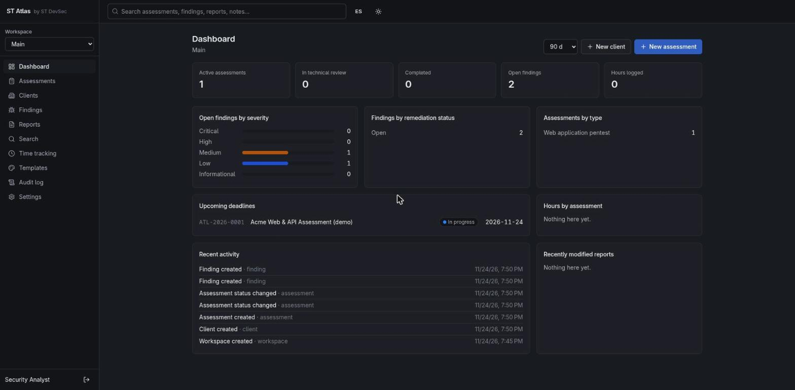

### Clientes y assessments
| Clientes | Assessments |
|---|---|
| 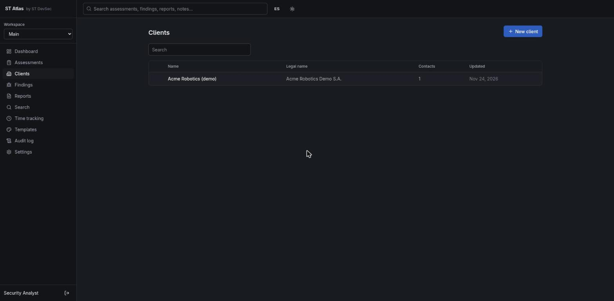 | 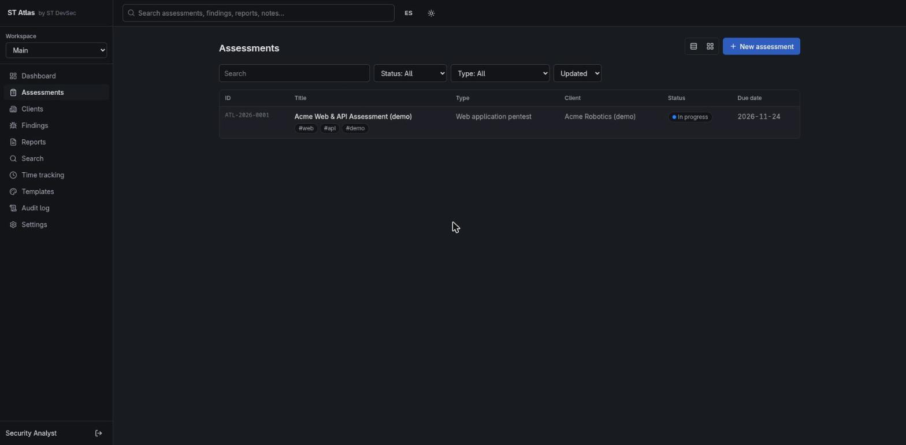 |

Un assessment tiene alcance, reglas de enfrentamiento, metodología, un ciclo de
estados y sus propios hallazgos, reportes y tiempos.

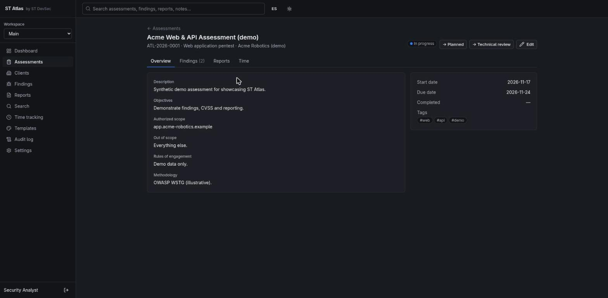

### Hallazgos con CVSS del lado del servidor
Cada hallazgo lleva un vector CVSS 3.1; el puntaje y la severidad se calculan en
el **servidor**, nunca se confían al navegador.

| Lista de hallazgos | Editor de hallazgo |
|---|---|
| 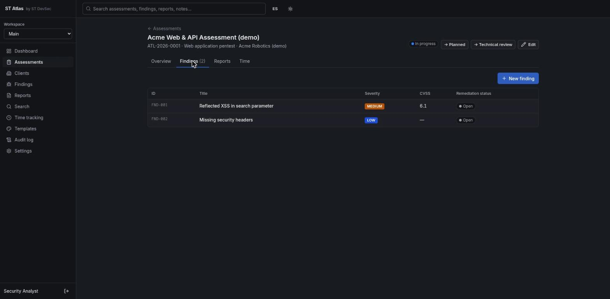 | 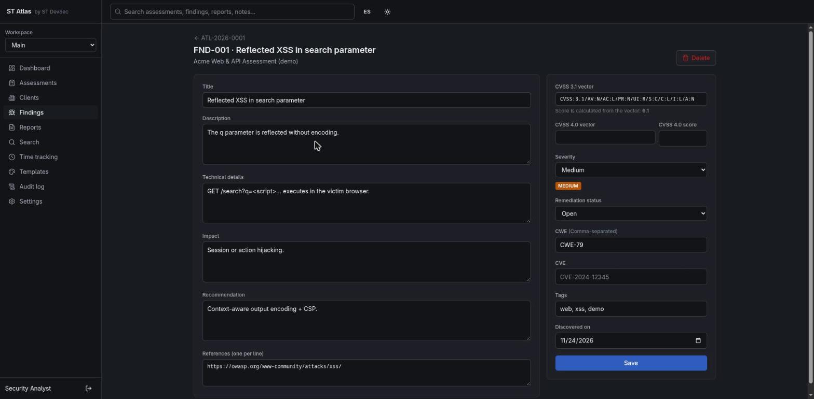 |

### Report Studio → PDF
Redacta reportes en un editor enriquecido (variables de plantilla, tabla de
hallazgos, imágenes de evidencia, saltos de página). Genera un PDF versionado e
inmutable con Gotenberg y léelo en el visor integrado.

| Report Studio | Visor PDF | Salida PDF |
|---|---|---|
| 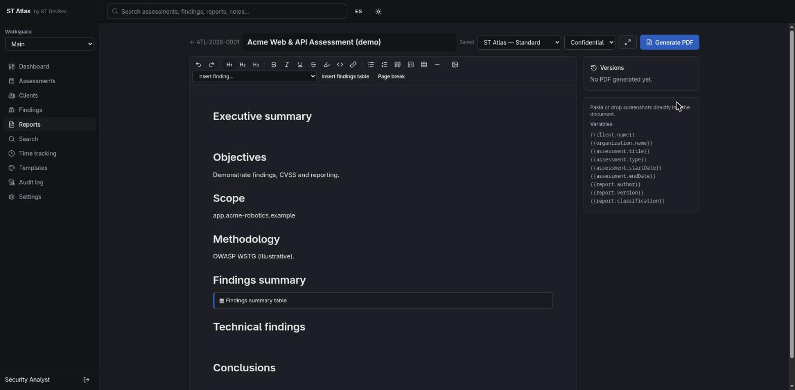 | 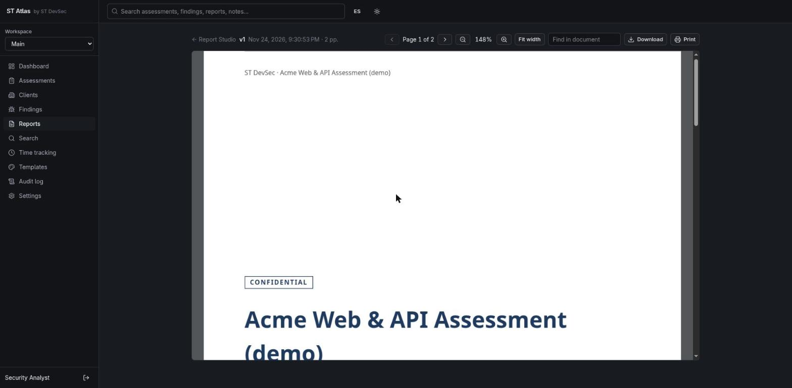 | 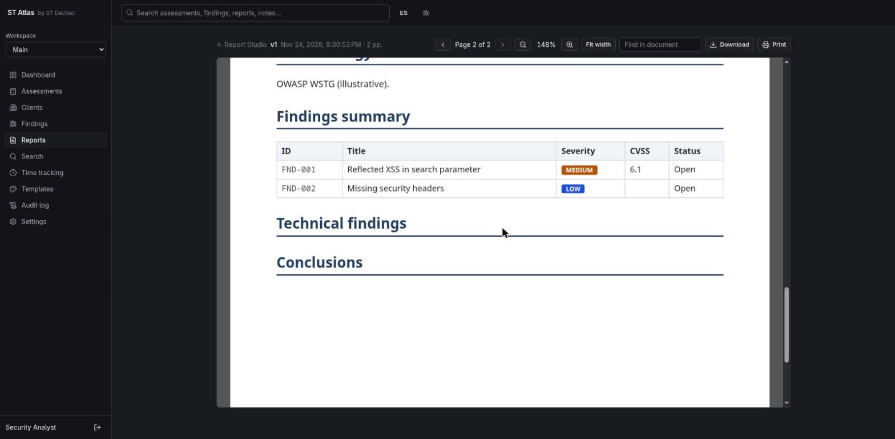 |

### Búsqueda, plantillas y ajustes
Búsqueda de texto completo de Postgres (ES/EN) con resaltado y nube de
etiquetas; plantillas de PDF configurables; perfil, MFA, miembros y roles del
espacio de trabajo.

| Búsqueda | Plantillas | Ajustes |
|---|---|---|
| 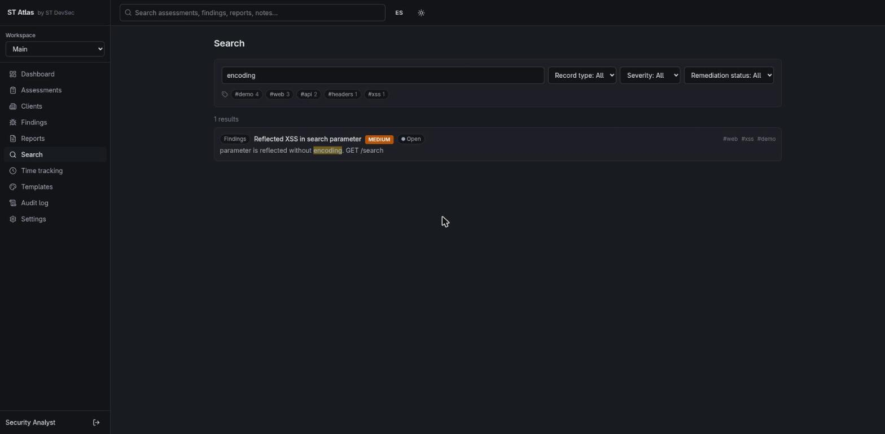 | 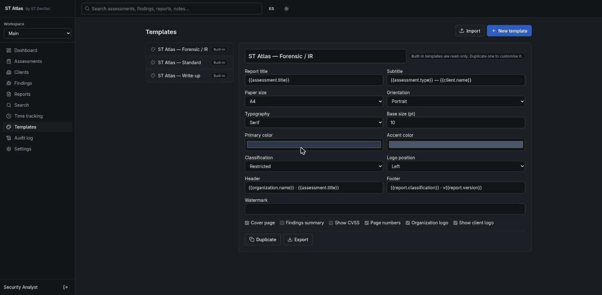 | 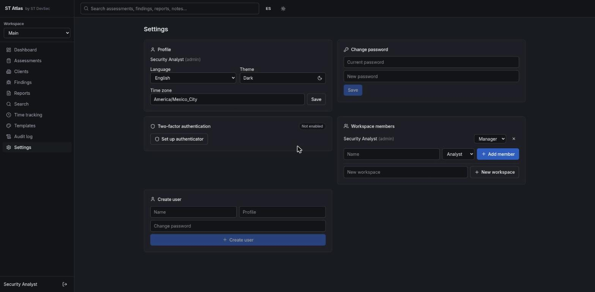 |

---

## Funcionalidades

- **Clientes y contactos** — organizaciones, contactos, logo opcional.
- **Assessments** — alcance, fuera de alcance, reglas de enfrentamiento,
  metodología, etiquetas y un ciclo de estados (Borrador → Planeado → En curso →
  Revisión técnica → …).
- **Hallazgos** — vectores CVSS 3.1 (y 4.0 opcional) puntuados en el servidor,
  referencias CWE/CVE, estado de remediación, evidencia.
- **Report Studio** — editor Tiptap con variables de plantilla, tabla resumen de
  hallazgos, saltos de página y evidencia pegada/arrastrada (guardada como
  adjuntos, nunca como Base64 incrustado).
- **Reportes PDF** — renderizados por Gotenberg desde un renderer con lista
  blanca del lado del servidor; las versiones finalizadas son inmutables y el
  visor PDF.js integrado permite zoom, búsqueda, descarga e impresión.
- **Plantillas** — plantillas de reporte integradas y personalizadas (tamaño de
  papel, orientación, colores, fuentes, clasificación, interruptores);
  duplicar/exportar/importar.
- **Búsqueda** — texto completo en español e inglés con `pg_trgm`, snippets
  resaltados y filtros por etiqueta.
- **Control de tiempos** — temporizador start/stop y entradas manuales, export
  CSV (con protección contra inyección de fórmulas).
- **Bitácora de auditoría** — registro de solo anexado de cada cambio.
- **Cuentas** — hash de contraseñas con Argon2, MFA TOTP, rate limiting,
  bloqueo, acceso por roles (Manager / Analyst), gestión de usuarios admin.
- **i18n** — interfaz completa en español e inglés, temas claro y oscuro.

## Tecnologías

| Capa | Stack |
|---|---|
| Frontend | Angular 22 (standalone, zoneless, signals), Tailwind 4, Tiptap 3, PDF.js |
| Backend | Spring Boot 4.2 · Java 21 · Spring Modulith · Spring Security 7 · Hibernate 7 · Flyway |
| Datos | PostgreSQL 18 (FTS + `pg_trgm`) |
| PDF | Gotenberg 9 (HTML → PDF; JavaScript desactivado) |
| Borde | nginx (sin privilegios), proxy inverso + SPA estática |
| Empaquetado | Docker Compose (builds multi-etapa) |

---

## Inicio rápido (local)

### Requisitos
- **Docker Engine** con los plugins **Compose v2** y **Buildx**.
  En Arch Linux: `sudo pacman -S docker docker-compose docker-buildx`.
  *(Buildx es necesario para los cache mounts de BuildKit en los Dockerfiles.)*
- ~2 GB de RAM libre para el stack.

### 1. Construir y levantar
```bash
git clone https://github.com/STDevSec/ST-Atlas.git
cd ST-Atlas
docker compose up -d --build
```
Solo el contenedor `web` publica un puerto — `http://localhost:8080`, atado a
`127.0.0.1`. La base de datos, el backend y Gotenberg quedan en redes internas
sin acceso a internet. Las credenciales de servicio se generan en el primer
arranque (sin contraseñas por defecto).

### 2. Obtener el token de configuración inicial
El token se imprime **una sola vez** en el log del backend (nunca se expone por
HTTP):
```bash
docker compose logs backend | grep -A2 "setup token"
```

### 3. Completar la configuración inicial
Abre `http://localhost:8080`, pega el token y crea tu organización, primer
espacio de trabajo y cuenta admin (tú eliges la contraseña — no hay admin por
defecto).

### 4. (Opcional) Cargar datos demo
Para poblar una instancia desechable con el dataset sintético de las capturas:
```bash
ATLAS_ADMIN_USERNAME=admin ATLAS_ADMIN_PASSWORD='<tu-contraseña>' \
  ./scripts/demo-seed.sh
```
> Los datos demo están claramente etiquetados y son sintéticos. Nunca lo corras
> contra una instancia real.

### Configuración (opcional)
`docker compose up -d` funciona sin configuración. Para cambiar la dirección de
escucha, el puerto, el límite de subida, el timeout de sesión o activar cookies
HTTPS, copia `.env.example` a `.env` y edítalo. **No** subas `.env`.

---

## Uso diario

1. **Crea un cliente** (Clientes → Nuevo cliente).
2. **Crea un assessment** para ese cliente; define alcance, reglas de
   enfrentamiento y metodología; muévelo por su ciclo de estados.
3. **Agrega hallazgos** con un vector CVSS — el puntaje y la severidad se
   calculan por ti. Adjunta imágenes de evidencia.
4. **Redacta un reporte** en Report Studio: elige plantilla, inserta la tabla
   resumen de hallazgos, pega evidencia, agrega saltos de página.
5. **Genera el PDF.** Cada generación es una nueva versión inmutable; léela en
   el visor integrado o descárgala/imprímela.
6. **Busca** en todo, **registra tiempo** contra el assessment y revisa la
   **bitácora de auditoría**.

---

## Operar el stack

### Scripts de ayuda (`scripts/`)
| Script | Qué hace |
|---|---|
| `backup.sh` | `pg_dump` + archivo del almacenamiento, comprimido, a un archivo con fecha. |
| `restore.sh` | Restaura un respaldo (confirmación interactiva; reemplaza los datos actuales). |
| `health-check.sh` | Estado de contenedores + chequeos HTTP del perímetro; salida distinta de cero si falla. |
| `demo-seed.sh` | Carga el dataset demo sintético vía la API. |

### Detener
```bash
docker compose stop        # detiene contenedores, conserva todos los datos
docker compose start       # los vuelve a arrancar
```

### Apagar (conservando datos)
```bash
docker compose down        # elimina contenedores + redes; los volúmenes se CONSERVAN
```
Tu base de datos y archivos subidos viven en volúmenes con nombre (`pgdata`,
`storage`) y sobreviven a esto. Vuelve a levantar todo con `docker compose up -d`.

### Desinstalar (borrar todo)
> ⚠️ **Esto elimina permanentemente todos los datos** — base de datos, archivos
> subidos, PDFs generados y las credenciales de servicio. Haz un respaldo
> primero si quieres conservar algo (`./scripts/backup.sh`).

```bash
# Elimina contenedores, redes Y los volúmenes con nombre, más las imágenes locales:
docker compose down -v --rmi local

# Luego elimina el repositorio clonado:
cd ..
rm -rf ST-Atlas
```
Las imágenes base descargadas (postgres, gotenberg, nginx, …) quedan en tu caché
local de Docker; elimínalas con `docker image prune -a` si también quieres
quitarlas.

---

## Postura de seguridad

- Escucha en `127.0.0.1` por defecto; pon tu propio terminador TLS enfrente para
  acceso remoto.
- Solo el contenedor `web` (nginx) publica un puerto. PostgreSQL, el backend y
  Gotenberg están en redes Docker **internas** y no son accesibles desde el host.
- **Sin credenciales por defecto**: las contraseñas de servicio se generan en el
  primer arranque; la cuenta admin la creas tú en la configuración inicial.
- Hash de contraseñas con Argon2, MFA TOTP, rate limiting y bloqueo de login.
- Cookie de sesión HttpOnly; protección CSRF en peticiones que cambian estado;
  sin tokens en `localStorage`.
- Content-Security-Policy fuerte, `X-Content-Type-Options: nosniff`,
  `X-Frame-Options: DENY`; `/actuator` bloqueado en el borde.
- Gotenberg corre con JavaScript desactivado, sin descargas remotas, sin webhooks.
- Todos los contenedores corren sin privilegios, read-only, con `cap_drop: ALL`
  y `no-new-privileges`.

**Uso previsto:** ST Atlas es una herramienta para documentar y reportar
evaluaciones de seguridad **autorizadas**. Eres responsable de operarla
legalmente y solo contra sistemas que tengas autorización para probar.

---

## ST DevSec

ST Atlas es un producto de **ST DevSec**. Es software pre-release sin garantía;
la licencia aún no está decidida (todos los derechos reservados por ahora).

---

*Aún sin logo oficial — el wordmark “ST Atlas” es un marcador de posición.*
