# ST Atlas

**Self-hosted security assessment & reporting platform** — by [ST DevSec](#st-devsec).

Run security engagements end to end: track clients and assessments, document
findings with server-computed **CVSS 3.1**, write reports in a rich editor with
evidence images, and export finalized, immutable **PDF reports**. Full-text
search (EN/ES), time tracking, MFA, an append-only audit log, and role-based
workspaces — shipped as a hardened Docker Compose stack that binds to
`localhost` and generates its own service credentials on first start.

> **Status:** `v0.1` pre-release. The application is feature-complete and verified
> end to end; documentation and CI are still being filled in. See
> [`docs/development/IMPLEMENTATION_STATUS.md`](docs/development/IMPLEMENTATION_STATUS.md)
> for the truthful, dated state.
>
> **License:** not chosen yet — all rights reserved for now. Do not redistribute
> until a `LICENSE` is committed.
>
> *README · [Español](README.es.md)*

---

## Screenshots

All screenshots use synthetic demo data (Acme Robotics) in dark mode.

### Dashboard
Open findings by severity, remediation status, deadlines, and recent activity.

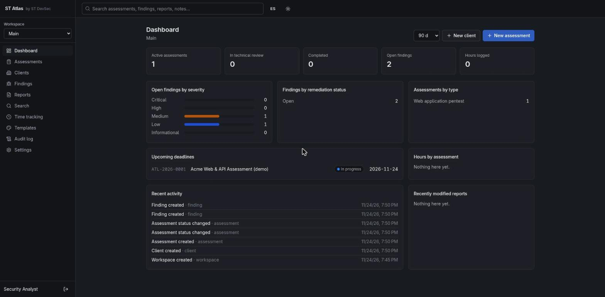

### Clients & assessments
| Clients | Assessments |
|---|---|
| 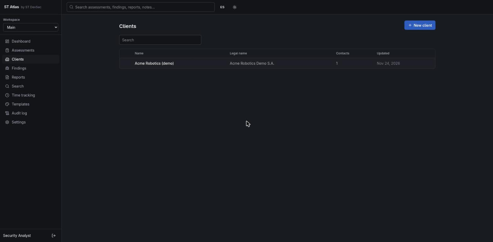 | 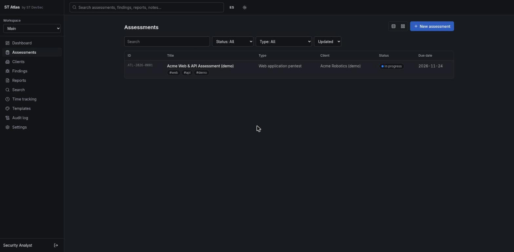 |

An assessment has scope, rules of engagement, methodology, a status lifecycle,
and its own findings, reports and time entries.

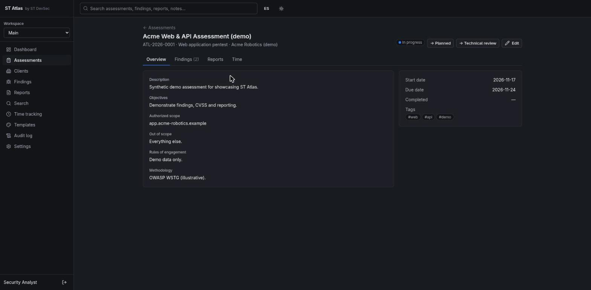

### Findings with server-side CVSS
Findings carry a CVSS 3.1 vector; the score and severity are computed on the
**server**, never trusted from the browser.

| Findings list | Finding editor |
|---|---|
| 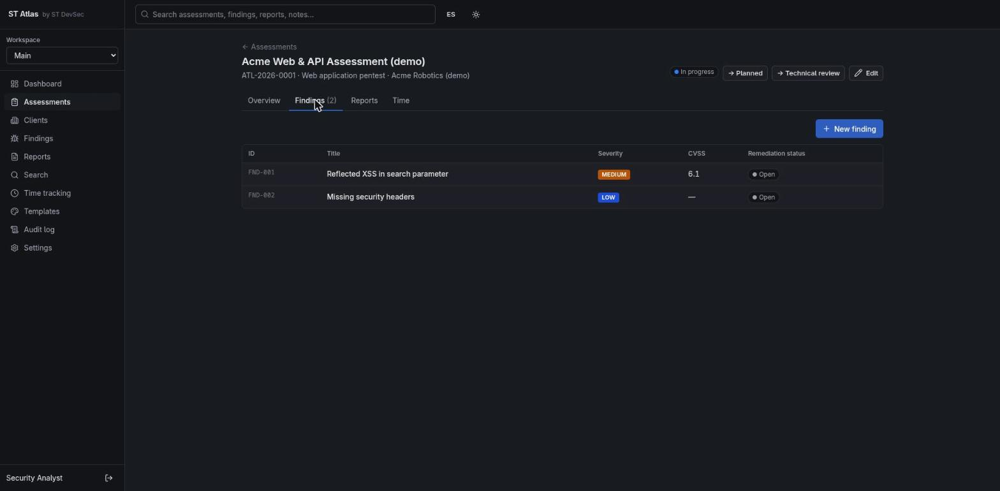 | 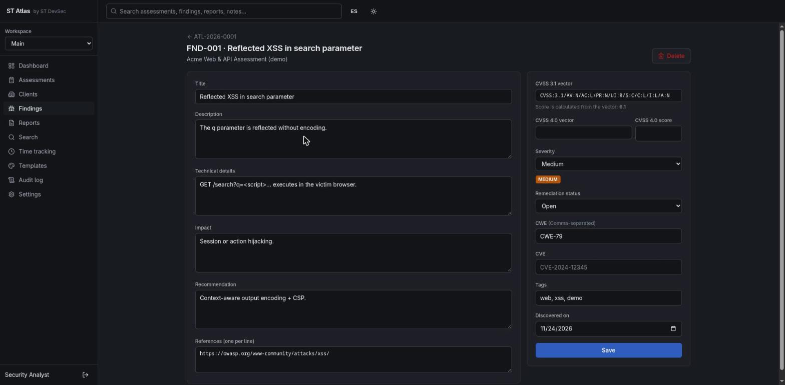 |

### Report Studio → PDF
Write reports in a rich editor (template variables, findings table, evidence
images, page breaks). Generate a versioned, immutable PDF via Gotenberg and read
it in the built-in viewer.

| Report Studio | PDF viewer | PDF output |
|---|---|---|
| 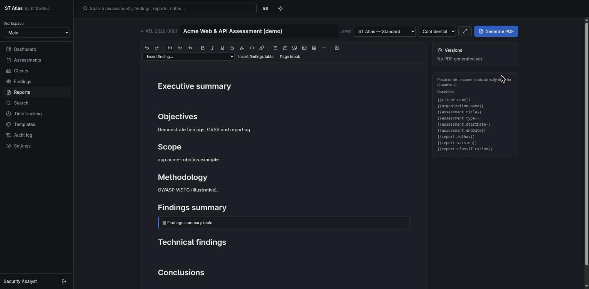 | 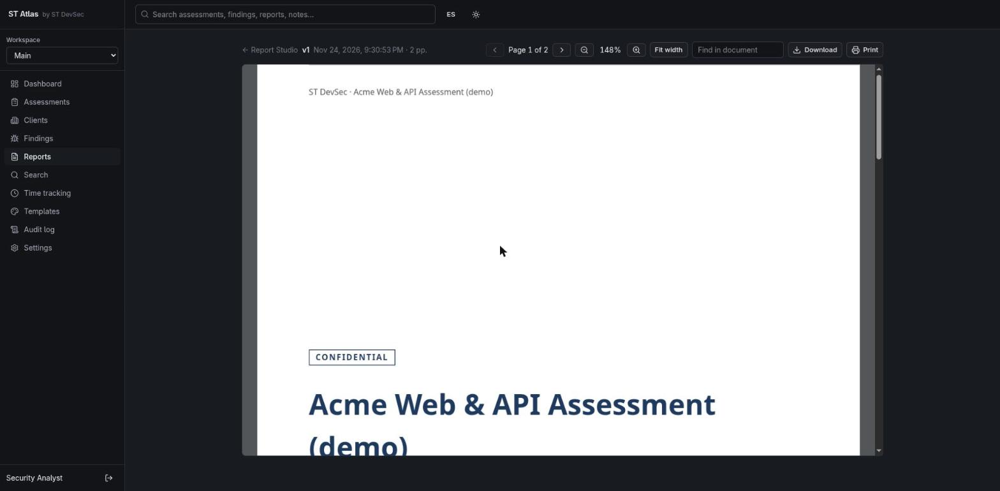 | 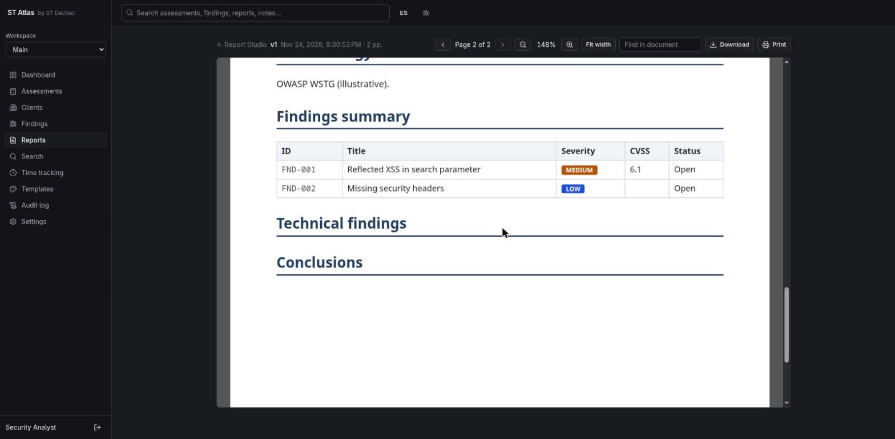 |

### Search, templates & settings
Postgres full-text search (EN/ES) with highlighted snippets and a tag cloud;
configurable PDF templates; profile, MFA, workspace members and roles.

| Search | Templates | Settings |
|---|---|---|
| 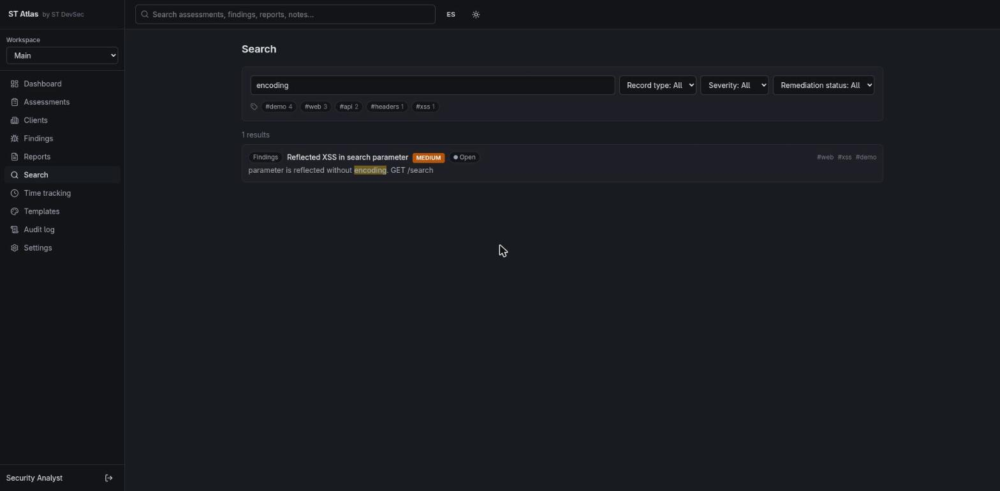 | 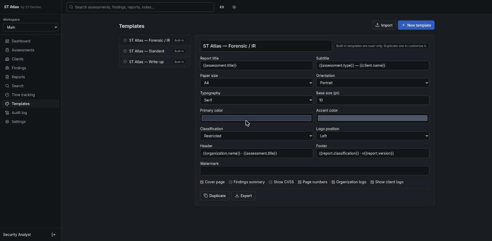 | 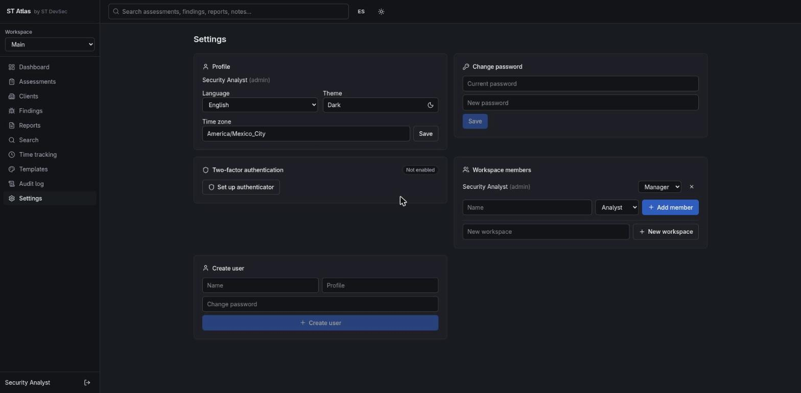 |

---

## Features

- **Clients & contacts** — organizations, contacts, optional logo.
- **Assessments** — scope, out-of-scope, rules of engagement, methodology,
  tags, and a status lifecycle (Draft → Planned → In progress → Technical
  review → …).
- **Findings** — CVSS 3.1 (and optional 4.0) vectors scored server-side,
  CWE/CVE references, remediation status, evidence.
- **Report Studio** — Tiptap editor with template variables, a findings summary
  table, page breaks, and paste/drop evidence images (stored as attachments,
  never inline Base64).
- **PDF reports** — rendered by Gotenberg from a server-side allow-listed
  renderer; finalized versions are immutable and the built-in PDF.js viewer
  supports zoom, search, download and print.
- **Templates** — built-in report templates plus custom ones (paper size,
  orientation, colors, fonts, classification, toggles); duplicate/export/import.
- **Search** — PostgreSQL full-text search in English and Spanish with
  `pg_trgm`, highlighted snippets, and tag filters.
- **Time tracking** — start/stop timer and manual entries, CSV export (with
  formula-injection guard).
- **Audit log** — append-only record of every change.
- **Accounts** — Argon2 password hashing, TOTP MFA, rate limiting, lockout,
  role-based workspace access (Manager / Analyst), admin user management.
- **i18n** — full English / Spanish UI, light & dark themes.

## Tech stack

| Layer | Stack |
|---|---|
| Frontend | Angular 22 (standalone, zoneless, signals), Tailwind 4, Tiptap 3, PDF.js |
| Backend | Spring Boot 4.2 · Java 21 · Spring Modulith · Spring Security 7 · Hibernate 7 · Flyway |
| Data | PostgreSQL 18 (FTS + `pg_trgm`) |
| PDF | Gotenberg 9 (HTML → PDF; JavaScript disabled) |
| Edge | nginx (unprivileged), reverse proxy + static SPA |
| Packaging | Docker Compose (multi-stage builds) |

---

## Quick start (local)

### Prerequisites
- **Docker Engine** with the **Compose v2** and **Buildx** plugins.
  On Arch Linux: `sudo pacman -S docker docker-compose docker-buildx`.
  *(Buildx is required for the BuildKit cache mounts in the Dockerfiles.)*
- ~2 GB free RAM for the stack.

### 1. Build and start
```bash
git clone https://github.com/STDevSec/ST-Atlas.git
cd ST-Atlas
docker compose up -d --build
```
Only the `web` container publishes a port — `http://localhost:8080`, bound to
`127.0.0.1`. The database, backend and Gotenberg stay on internal networks with
no internet access. Random service credentials are generated on first start
(no default passwords).

### 2. Get the first-run setup token
The token is printed **once** to the backend log (never exposed over HTTP):
```bash
docker compose logs backend | grep -A2 "setup token"
```

### 3. Complete first-run setup
Open `http://localhost:8080`, paste the token, and create your organization,
first workspace, and admin account (you choose the password — there is no
default admin).

### 4. (Optional) Load demo data
To populate a throwaway instance with the synthetic dataset from the
screenshots:
```bash
ATLAS_ADMIN_USERNAME=admin ATLAS_ADMIN_PASSWORD='<your-password>' \
  ./scripts/demo-seed.sh
```
> Demo data is clearly labelled and synthetic. Never run this against a real
> instance.

### Configuration (optional)
`docker compose up -d` works with no config. To change the bind address, port,
upload limit, session timeout or enable HTTPS cookies, copy `.env.example` to
`.env` and edit it. Do **not** commit `.env`.

---

## Everyday use

1. **Create a client** (Clients → New client).
2. **Create an assessment** for that client; fill in scope, rules of engagement,
   and methodology; move it through its status lifecycle.
3. **Add findings** with a CVSS vector — the score and severity are computed
   for you. Attach evidence images.
4. **Write a report** in Report Studio: pick a template, insert the findings
   summary table, paste evidence, add page breaks.
5. **Generate the PDF.** Each generation is a new immutable version; read it in
   the built-in viewer, or download/print it.
6. **Search** across everything, **track time** against the assessment, and
   review the **audit log**.

---

## Operating the stack

### Helper scripts (`scripts/`)
| Script | What it does |
|---|---|
| `backup.sh` | `pg_dump` + storage archive, gzipped, to a timestamped file. |
| `restore.sh` | Restore a backup (interactive confirmation; replaces current data). |
| `health-check.sh` | Container status + HTTP perimeter checks; non-zero exit on failure. |
| `demo-seed.sh` | Load the synthetic demo dataset via the API. |

### Stop
```bash
docker compose stop        # stop containers, keep all data
docker compose start       # start them again
```

### Shut down (keep data)
```bash
docker compose down        # remove containers + networks; volumes are KEPT
```
Your database and uploaded files live in named volumes (`pgdata`, `storage`) and
survive this. Bring everything back with `docker compose up -d`.

### Uninstall (delete everything)
> ⚠️ **This permanently deletes all data** — database, uploaded files, generated
> PDFs, and the generated service credentials. Make a backup first if you want
> to keep anything (`./scripts/backup.sh`).

```bash
# Remove containers, networks, AND the named volumes, plus the locally built images:
docker compose down -v --rmi local

# Then remove the cloned repository:
cd ..
rm -rf ST-Atlas
```
The pulled base images (postgres, gotenberg, nginx, …) remain in your local
Docker cache; remove them with `docker image prune -a` if you also want those
gone.

---

## Security posture

- Binds to `127.0.0.1` by default; put your own TLS terminator in front for
  remote access.
- Only the `web` (nginx) container publishes a port. PostgreSQL, the backend and
  Gotenberg are on **internal** Docker networks and are not reachable from the
  host.
- **No default credentials**: service passwords are generated on first start;
  the admin account is created by you during first-run setup.
- Argon2 password hashing, TOTP MFA, login rate limiting and lockout.
- Session cookie is HttpOnly; CSRF protection on state-changing requests; no
  tokens in `localStorage`.
- Strong Content-Security-Policy, `X-Content-Type-Options: nosniff`,
  `X-Frame-Options: DENY`; `/actuator` is blocked at the edge.
- Gotenberg runs with JavaScript disabled, no remote downloads, no webhooks.
- All containers run unprivileged, read-only, with `cap_drop: ALL` and
  `no-new-privileges`.

**Intended use:** ST Atlas is a tool for documenting and reporting **authorized**
security assessments. You are responsible for operating it lawfully and only
against systems you are authorized to test.

---

## ST DevSec

ST Atlas is a product of **ST DevSec**. It is pre-release software provided
without warranty; the license is not yet decided (all rights reserved for now).

---

*No official logo yet — the “ST Atlas” wordmark is a placeholder.*
