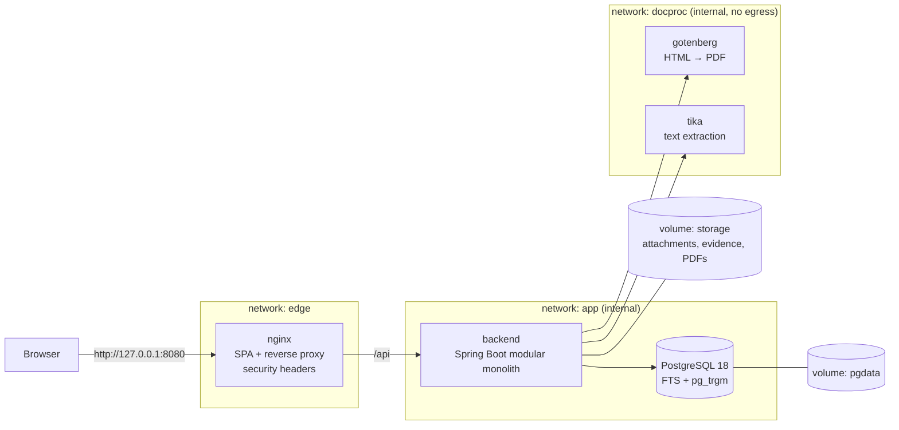
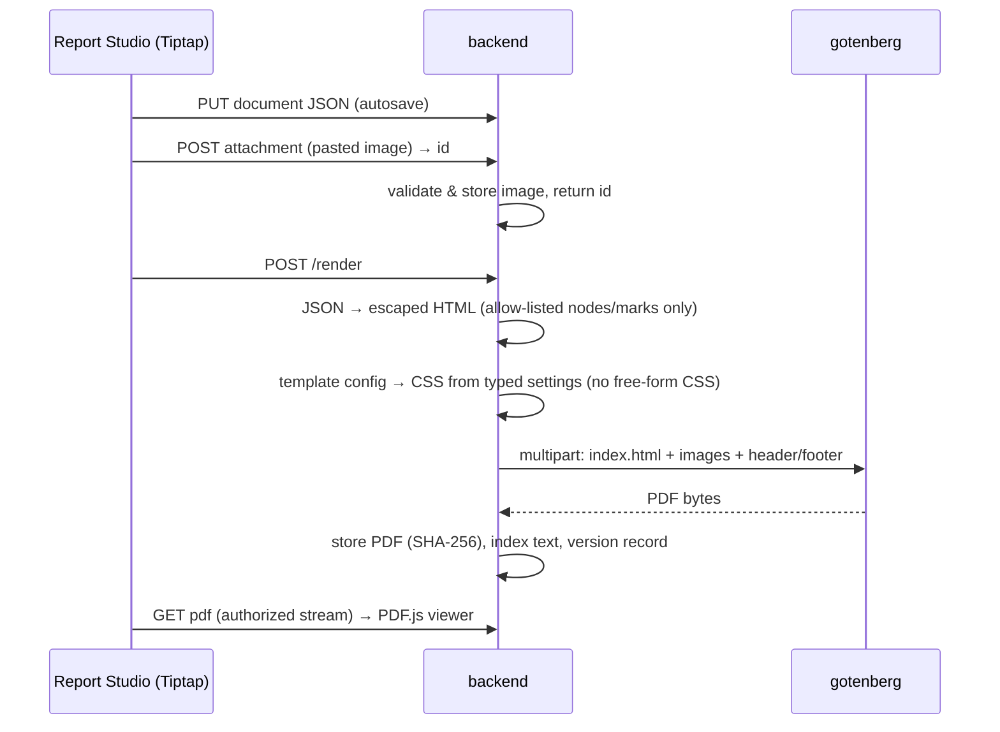

# Architecture

## Overview

A modular monolith (Spring Boot) behind an Nginx reverse proxy that also
serves the Angular single-page application. Two isolated helper services do
the risky document work: Gotenberg (HTML → PDF with Chromium) and Apache Tika
server (PDF text extraction). PostgreSQL stores everything except binary
files, which live on a dedicated volume.

- Only nginx publishes a port, on `127.0.0.1:8080` by default.
- `app` and `docproc` networks are `internal: true`: no container on them can
  reach the internet or the host LAN. PostgreSQL is never published.
- Gotenberg and Tika never see the database or storage; the backend sends
  them bytes and receives bytes.

## Request flow

1. The SPA calls `/api/v1/...` with the session cookie and the `X-XSRF-TOKEN`
   header (double-submit cookie).
2. Spring Security authenticates the session (Spring Session JDBC, so
   sessions survive restarts and can be revoked).
3. For workspace routes `/api/v1/workspaces/{id}/...`, `WorkspaceAccess`
   verifies membership and role **before** the controller touches a repository.
4. Services run in explicit transactions; every repository query is scoped by
   `workspace_id`.
5. Changes publish application events (Spring Modulith) consumed by `search`
   (re-index) and `audit` (record) in other modules, keeping modules decoupled.

## Report rendering pipeline

The HTML handed to Chromium contains no script, no remote URL and only
allow-listed elements generated by our renderer; Gotenberg runs with
JavaScript disabled and on a network without egress.

## Storage

Files are stored under `/data/storage/{workspaceId}/{yyyy}/{mm}/{uuid}`;
names are generated, never user-supplied. Metadata (original name, MIME,
size, SHA-256, uploader) is in PostgreSQL. Downloads go through authorized
endpoints with `Content-Disposition: attachment` (or `inline` for PDFs shown
in the viewer) and `X-Content-Type-Options: nosniff`. Nothing is served
statically.

## Search

A single `search_entry` table holds one row per searchable record
(assessment, finding, report version, knowledge article, imported PDF,
client) with workspace id, entity type, title, body text, tags and two
`tsvector` columns (English and Spanish stemming) plus a trigram index on
title for partial matches. Queries always add `workspace_id = ANY(:allowed)`
and, for client-restricted roles, the allowed assessment ids, so counts,
snippets and suggestions cannot leak (see THREAT_MODEL.md, T-07).

## Deployment

`compose.yaml` builds three images locally (frontend+nginx, backend) and uses
pinned upstream images for PostgreSQL, Gotenberg and Tika. Health checks gate
start-up order. See `docs/deployment/INSTALLATION.md`.
