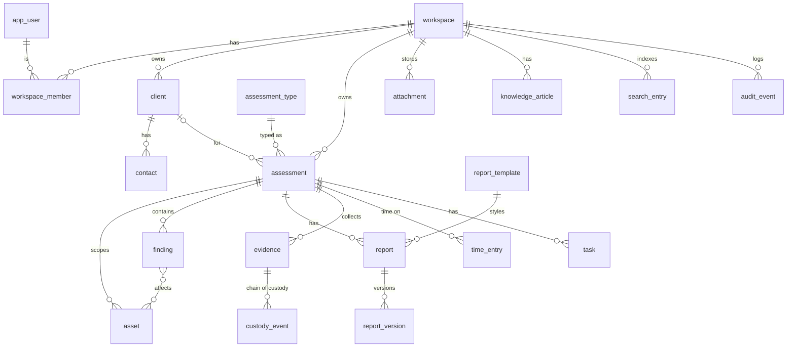

# Data model

PostgreSQL 18. Primary keys are UUIDs generated by the application (v7,
time-ordered). Every workspace-owned table has `workspace_id NOT NULL` with a
foreign key and an index; composite foreign keys include `workspace_id` where
a child must belong to the same workspace as its parent (prevents
cross-workspace references even if application code had a bug).
Timestamps are `timestamptz` (UTC). Soft-deletion is not used; archival is a
status. Migrations: `backend/src/main/resources/db/migration`.

## Main tables (v0.1)

| Table | Key columns | Notes |
|---|---|---|
| `app_user` | id, username (unique, citext), display_name, password_hash, mfa_secret_enc, mfa_enabled, locale, time_zone, is_admin, enabled, created_at | Argon2id hash; MFA secret encrypted with the instance key |
| `recovery_code` | id, user_id, code_hash, used_at | one-time, hashed |
| `instance_setting` | key, value | setup completion flag, organisation name, defaults |
| `workspace` | id, name, slug, created_at | |
| `workspace_member` | workspace_id, user_id, role | role ∈ MANAGER, ANALYST, REVIEWER, VIEWER |
| `client` | id, workspace_id, name, legal_name, website, notes, logo_attachment_id | |
| `contact` | id, workspace_id, client_id, name, email, phone, kind | kind ∈ TECHNICAL, ADMINISTRATIVE, OTHER |
| `assessment_type` | code (pk), uses_cvss, default_sections jsonb | 20 built-in rows; configurable |
| `assessment` | id, workspace_id, code, title, description, type_code, client_id, status, start_date, due_date, completed_date, objectives, scope, out_of_scope, rules_of_engagement, methodology, tags text[], created_by, timestamps | code like `ATL-2026-0001` unique per workspace |
| `assessment_analyst` | assessment_id, user_id | |
| `asset` | id, workspace_id, assessment_id, name, kind, identifier, in_scope | |
| `finding` | id, workspace_id, assessment_id, code, title, description, technical_details, severity, cvss31_vector, cvss31_score, cvss40_vector, cvss40_score, cwe text[], cve text[], impact, recommendation, references text[], tags text[], status, discovered_on, analyst_id, timestamps | severity/status enums as text + CHECK |
| `finding_asset` | finding_id, asset_id | |
| `attachment` | id, workspace_id, storage_key, original_name, mime_type, size_bytes, sha256, uploaded_by, created_at | binary on the storage volume |
| `report` | id, workspace_id, assessment_id, title, template_id, document jsonb, current_version, updated_at | `document` is Tiptap JSON; images reference attachment ids |
| `report_version` | id, workspace_id, report_id, number, document jsonb, pdf_attachment_id, finalized, created_by, created_at | finalized rows are immutable (trigger) |
| `report_template` | id, workspace_id (null = built-in), name, config jsonb | typed config, validated server-side |
| `time_entry` | id, workspace_id, assessment_id, user_id, started_at, ended_at, duration_seconds, billable, description | running timer = ended_at null (one per user, partial unique index) |
| `search_entry` | id, workspace_id, entity_type, entity_id, assessment_id, title, body, tags, updated_at, tsv_en, tsv_es | GIN on tsvectors, GIN trgm on title |
| `audit_event` | id, workspace_id (nullable), actor_id, action, entity_type, entity_id, ip, at, details jsonb | append-only |
| `SPRING_SESSION*` | (Spring Session JDBC) | persistent, revocable sessions |

Tables for evidence/custody, knowledge articles, tasks and PDF imports are
added in v0.2 (see BACKLOG.md); this document is updated with each migration.
