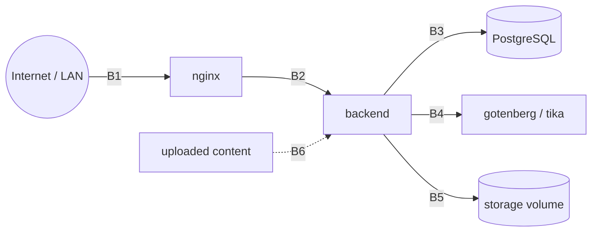

# Threat model

Method: STRIDE per trust boundary, plus abuse cases. Reviewed with every
security-relevant change. Status of each mitigation is tracked in
`docs/development/IMPLEMENTATION_STATUS.md`.

## Assets worth protecting

1. Client confidential data: findings, reports, evidence, scope, contacts.
2. Credentials: password hashes, MFA secrets, recovery codes, sessions.
3. Integrity of evidence and finalised reports (chain of custody, legal value).
4. Availability of the installation (a consultant's only copy of their work).

## Actors

| Actor | Trust |
|---|---|
| Installation owner (admin) | trusted |
| Workspace member (manager/analyst/reviewer/viewer) | trusted within their workspace and role only |
| Member of another workspace on the same instance | **untrusted** for this workspace |
| Unauthenticated network user | untrusted |
| Uploaded files, pasted images, imported PDFs | **hostile input** |
| Client-provided documents rendered in reports | hostile input |

## Trust boundaries

- **B1** browser ↔ nginx: public surface (login, setup, SPA assets).
- **B2** nginx ↔ backend: all API traffic; authentication and authorization.
- **B3** backend ↔ database: SQL; workspace scoping.
- **B4** backend ↔ document processors: hostile content processing.
- **B5** backend ↔ file storage: paths, file names.
- **B6** untrusted content entering through uploads, paste, import, templates.

## Threats and mitigations

| ID | Threat (STRIDE) | Boundary | Mitigation |
|---|---|---|---|
| T-01 | Remote takeover of an uninstalled instance (someone else completes setup first) (E) | B1 | setup requires a one-time token printed only in the backend log; setup endpoints disabled after completion; default bind 127.0.0.1 |
| T-02 | Credential stuffing / brute force (S) | B1 | Argon2id; per-IP and per-account rate limiting with back-off; generic error messages; optional TOTP MFA |
| T-03 | Session theft / fixation (S) | B1/B2 | HttpOnly SameSite=Strict cookie, session id rotated on login, Secure flag behind HTTPS, idle + absolute timeout, server-side revocation (JDBC sessions), no tokens in localStorage |
| T-04 | CSRF on state-changing endpoints (T) | B2 | double-submit `XSRF-TOKEN` cookie + header; SameSite=Strict |
| T-05 | Broken object-level authorization across workspaces (I/E) | B2/B3 | path-scoped workspace ids, central `WorkspaceAccess` check before repository calls, every query filters `workspace_id`, composite FKs, 404 for inaccessible resources, isolation tests per endpoint |
| T-06 | Privilege escalation inside a workspace (E) | B2 | role checks per operation (viewer read-only, reviewer cannot delete, only managers manage members); tests per role |
| T-07 | Search leaks confidential data via counts, snippets or suggestions (I) | B3 | search filters by allowed workspaces before ranking; snippets built only from permitted rows; totals computed on the same filtered query; no cross-workspace autocomplete |
| T-08 | SQL injection (T/I) | B3 | JPA/parameterised queries only; dynamic sort fields from allow-lists; full-text queries via `websearch_to_tsquery` parameters |
| T-09 | Stored XSS through rich text, finding fields or file names (T/E) | B2/B6 | Tiptap JSON (not HTML) stored; frontend renders via Tiptap/Angular escaping only; backend renderer escapes all text and allow-lists node/mark types and link schemes (http, https, mailto); strict CSP without `unsafe-inline` scripts |
| T-10 | Malicious upload: polyglots, HTML/SVG with script, executables, oversized files, decompression bombs (T/E/D) | B6/B5 | content-based MIME detection (Tika core, detection only); allow-list per use (images: PNG/JPEG/WebP/GIF; SVG rejected); size limits; archives never extracted; generated storage names; downloads with `nosniff` and `attachment`; image dimensions bounded |
| T-11 | Path traversal in storage (T/I) | B5 | storage keys are generated UUID paths; user file names are metadata only; resolved paths verified to stay under the storage root |
| T-12 | Renderer abuse: SSRF, local file read, JavaScript in HTML-to-PDF (I/E) | B4 | HTML generated by our allow-list renderer (no user HTML), images passed as files (no URLs); Gotenberg with JS disabled and URL deny-list; `docproc` network is internal (no egress, no access to DB) |
| T-13 | Parser exploits in PDF extraction (E/D) | B4 | Tika runs in its own container, non-root, read-only FS, no network egress, memory limit, request timeout |
| T-14 | Template injection (`{{...}}`) leading to code execution (E) | B6 | variables are a fixed allow-list replaced by a literal string substitution; no expression language, no script |
| T-15 | Tampering with evidence or finalised reports (T/R) | B3/B5 | SHA-256 stored at upload and re-verified on download/custody events; finalised versions immutable (DB trigger); custody events append-only |
| T-16 | Repudiation of sensitive actions (R) | B2 | append-only audit log for auth events, membership/role changes, exports, deletions, lifecycle transitions |
| T-17 | Sensitive data in logs or errors (I) | B2 | ProblemDetail with generic messages; no request bodies or credentials logged; masked identifiers in logs |
| T-18 | Denial of service via heavy renders/uploads/search (D) | B2/B4 | request size limits, rate limits on render/upload/search, renderer timeouts, container resource limits |
| T-19 | Secrets leakage from images or repository (I) | — | secrets only via `.env` (git-ignored) and Docker secrets; images contain no secrets; gitleaks in CI |
| T-20 | Supply chain (dependency compromise) (T) | — | pinned versions and lockfiles, Dependabot, Trivy/CodeQL scans, SBOM |

## Abuse cases

1. *A member of workspace A guesses a finding UUID from workspace B.* → 404, nothing logged as existing (T-05).
2. *An analyst pastes an SVG with `<script>` into the editor.* → upload rejected (415) (T-10).
3. *A client-supplied PDF exploits the extractor.* → contained in the Tika container with no network and no data access (T-13).
4. *A template sets a header to ``.* → template fields are plain text; no HTML; renderer has no egress (T-12/T-14).
5. *Someone on the LAN reaches a fresh install before the owner.* → bound to 127.0.0.1 by default; even if exposed, setup needs the log token (T-01).

## Out of scope / accepted risks

- A malicious installation administrator (they own the host).
- Host compromise and physical access (use disk encryption; see HARDENING.md).
- Attacks requiring a compromised browser or client device.
